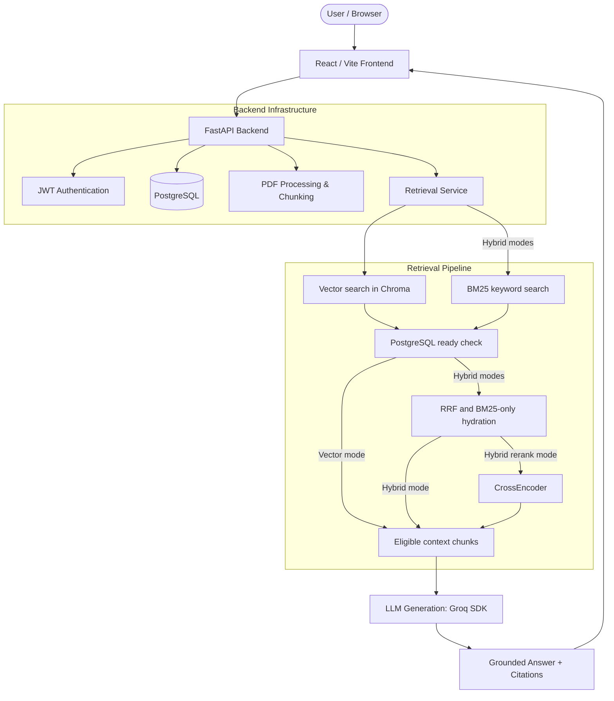

# InCite

InCite is a multi-user PDF RAG (Retrieval-Augmented Generation) application where users can create collections, upload documents, and ask questions grounded in those documents. Built with FastAPI, PostgreSQL, Chroma, and React, it checks document eligibility before generation and returns document, page, and text citations for grounded QA responses.

---

## Features

- **User Authentication & Multi-Tenancy**: JWT authentication and collection ownership checks scope chat and retrieval to authorized users.
- **Topic Collections**: Group related PDF documents into logical collections to scope searches and chat sessions.
- **PDF Processing & Chunking**: Background PDF ingestion using PyMuPDF (`fitz`), text extraction, and configurable sliding-window text chunking (`CHUNK_SIZE=1000`, `CHUNK_OVERLAP=150`).
- **Dense Vector Retrieval**: Local semantic vector search powered by `sentence-transformers/all-MiniLM-L6-v2` embeddings and embedded Chroma vector database (`PersistentClient`).
- **Lexical BM25 Retrieval**: In-memory Okapi BM25 keyword search (`rank-bm25`) scoped per collection to capture exact terms, codes, and technical names.
- **Hybrid Retrieval (RRF)**: Fusion of vector and BM25 candidate pools using Reciprocal Rank Fusion ($k=60$) to optimize retrieval quality across semantic and keyword queries.
- **Configurable Retrieval Modes**: Vector search is the configured default. Hybrid BM25 + vector search and hybrid with CrossEncoder reranking are optional.
- **Grounded answer generation** uses the official Groq Python SDK for QA, comparison, and recommendation, with fallback across configured models.
- **Citations for QA**: Structured citations identify the source document filename, page number, and relevant text snippet.
- **Confidence-Aware Filtering**: For QA, `MIN_CITATION_SCORE` filters weak evidence, and medium and high confidence thresholds classify the remaining evidence.
- **Cross-Document Comparison**: Specialized service to run queries across distinct documents in a collection and synthesize comparative analysis.
- **Grounded Follow-Up Suggestions**: Generates relevant follow-up questions tied to retrieved context for continued conversation flow.

---

## Why InCite?

Traditional RAG systems relying solely on dense vector embeddings often fail on exact keyword matches, technical codes, or domain-specific terminology. Conversely, pure keyword search misses conceptual synonyms and semantic context.

InCite addresses this by combining dense vector retrieval with sparse BM25 keyword retrieval using Reciprocal Rank Fusion (RRF). Furthermore, rather than assuming a working RAG pipeline is automatically effective, InCite incorporates a benchmark suite to quantitatively measure chunk-level retrieval accuracy (Recall@K, MRR, latency) across evaluation datasets.

---

## System Architecture



---

## RAG Pipeline

The InCite end-to-end RAG execution flow operates as follows:

1. **PDF Ingestion**: Users upload PDF files into a selected collection.
2. **Text Extraction**: PyMuPDF extracts raw text and page numbers from uploaded documents.
3. **Chunk Creation**: Text is partitioned into sliding-window chunks (1,000 characters, 150-character overlap by default).
4. **Embedding Generation**: Local `sentence-transformers/all-MiniLM-L6-v2` embeds text chunks on CPU.
5. **Vector Storage**: Embeddings and metadata are persisted in Chroma (`PersistentClient`).
6. **Candidate Retrieval**: Chat first authorizes the collection. Retrieval searches Chroma and, in hybrid modes, independently searches the collection's in-memory BM25 index.
7. **Eligibility and Ranking**: PostgreSQL verifies which candidate documents are ready in the collection and supplies their current filenames. Hybrid modes fuse the original ranks and fetch eligible BM25-only chunks from Chroma. Optional reranking sees only eligible text.
8. **Prompt and Response**: QA, comparison, and recommendation ground document claims in freshly retrieved evidence. Up to three recent user messages help interpret the request. Stored assistant replies stay in the displayed transcript. Groq generates the response when there is usable evidence. The shared empty-evidence response requires no model call.

---

## Retrieval Design

InCite implements and evaluates three distinct retrieval configurations:

### 1. Vector Search (`RETRIEVAL_MODE="vector"`) — Configured Default
Dense vector search using `all-MiniLM-L6-v2` embeddings and cosine distance in Chroma. Captures semantic intent but can miss exact keyword matches.

### 2. Hybrid Retrieval (`RETRIEVAL_MODE="hybrid"`)
Builds independent vector and BM25 pools of up to four times the requested result count each. Reciprocal Rank Fusion (RRF, $k=60$) ranks their union using the original rank positions. Eligible hits found only by BM25 are fetched from Chroma, and their metadata is checked against the requested chunk ID.

$$\text{RRF Score} = \sum_{m \in M} \frac{1}{k + r_m(d)}$$

Lexical search complements semantic retrieval on technical identifiers, code snippets, and exact names, while normalized RRF scores preserve citation threshold compatibility.

### 3. Hybrid + Reranker (`RETRIEVAL_MODE="hybrid_rerank"`) — Experimental Configuration
Feeds up to 15 eligible RRF candidates into a CrossEncoder model (`cross-encoder/ms-marco-MiniLM-L-6-v2`). If reranking fails, retrieval falls back to RRF order.

---

## Evaluation

InCite evaluates retrieval performance at chunk granularity using standard Information Retrieval metrics:
- **Recall@1 / Recall@3 / Recall@5**: Mean fraction of each question's labeled chunks retrieved within the top K results.
- **MRR (Mean Reciprocal Rank)**: Average reciprocal rank of the first relevant chunk ($1 / \text{rank}$).
- **p95 Latency**: 95th percentile query latency in milliseconds.
- **Document-level Hit Rates**: Secondary hit rate tracking at the document level.

### Evaluation Datasets

1. **Historical Human-Authored Benchmark**
   - Sample size: $n = 30$ questions.
   - Primary realistic evaluation set representing authentic user queries and intent distribution.
   - Ground-truth chunk mappings (`expected_chunks`) are frozen.

2. **Historical Synthetic Benchmark**
   - Sample size: $n = 527$ questions.
   - Supplementary large-scale evaluation set providing dense corpus coverage across all 1,258 stored chunks.
   - Generated from actual PostgreSQL chunks using local `qwen2.5:3b` via Ollama.

> **Methodological Limitation**: Because synthetic questions are generated directly from known source passages, they are naturally aligned with the target chunks and may be easier or more retrieval-oriented than ambiguous human queries. Synthetic benchmark metrics serve as supplementary evidence of corpus coverage and do not replace human-authored evaluation.

---

## Benchmark Results

These historical evaluations used local labeled datasets. The Phase 1A test rerun verifies safety and behavior and does not refresh these performance measurements.

### Human-Authored Benchmark ($n = 30$)

| Retrieval Configuration | Recall@1 | Recall@3 | Recall@5 | MRR | p95 Latency |
| :--- | :---: | :---: | :---: | :---: | :---: |
| **Vector-only Baseline** | 16.9% | 33.3% | 50.6% | 0.492 | **104 ms** |
| **Hybrid (BM25 + Vector + RRF)** | **26.4%** | **51.7%** | **66.4%** | **0.661** | **124 ms** |
| **Hybrid + Reranker** | 22.5% | 45.8% | 64.2% | 0.593 | 2,118 ms |

### Synthetic Benchmark ($n = 527$)

| Retrieval Configuration | Recall@1 | Recall@3 | Recall@5 | MRR | p95 Latency |
| :--- | :---: | :---: | :---: | :---: | :---: |
| **Vector-only Baseline** | 43.6% | 61.5% | 65.8% | 0.527 | **89 ms** |
| **Hybrid (BM25 + Vector + RRF)** | 57.3% | 76.7% | 83.5% | 0.675 | **122 ms** |
| **Hybrid + Reranker** | **63.2%** | **83.5%** | **89.8%** | **0.737** | 2,606 ms |

### Benchmark Interpretation & Engineering Decision

- **Hybrid Superiority**: Hybrid retrieval (BM25 + Vector + RRF) consistently outperformed vector-only search across both evaluation datasets, boosting human Recall@3 from 33.3% to 51.7% with minimal latency cost (+20 ms).
- **Dataset-Dependent Reranking**: Reranking performance varied by dataset. On human queries, CrossEncoder reranking reduced retrieval metrics while adding over 1.9 seconds of latency. On synthetic queries, reranking improved metrics but increased p95 latency by 21× (122 ms → 2,606 ms).
- **Configuration**: These results motivate offering hybrid retrieval as an option. The checked-in configuration defaults to `vector`.

---

## Tech Stack

- **Frontend**: React 18, Vite, React Router DOM, Lucide React, Vanilla CSS / TailwindCSS
- **Backend**: FastAPI 0.115, Python 3.11, SQLAlchemy 2.0, Alembic 1.13, Pydantic 2.9, PyMuPDF 1.24
- **Database**: PostgreSQL 16 in Docker Compose and the integration suite
- **Vector search and retrieval** use Chroma 0.5, `rank-bm25` 0.2.2, and `sentence-transformers` 3.2.0.
- **LLM integration** uses the official Groq Python SDK 0.37.1.
- **Infrastructure**: Docker, Docker Compose

---

## Project Structure

```text
incite/
├── app/
│   ├── api/routes/            # FastAPI API endpoint routers (auth, collections, docs, chat)
│   ├── core/                  # App configuration, DB session, LLM factory, embeddings
│   ├── models/                # SQLAlchemy database models
│   ├── repositories/          # Database data access layer
│   └── services/              # Business logic (retrieval, chat, ingestion, comparison)
├── docs/
│   ├── architecture.md        # System architecture and data flow
│   ├── design-decisions.md    # System design decision history
│   ├── decisions/             # Architectural decision records, including Phase 1A
│   ├── engineering-log.md     # Safety changes and verification results
│   ├── api.md                 # REST API documentation
│   └── database.md            # PostgreSQL database schema specification
├── frontend/                  # React + Vite web user interface
├── scripts/
│   ├── benchmark_retrieval_chunk.py    # Canonical chunk-level evaluation CLI
│   └── run_phase1a_integration.py       # Isolated unit and integration test runner
├── tests/                     # Unit tests and opt-in PostgreSQL/Chroma integration tests
├── docker-compose.yml         # Container orchestration definition
├── Dockerfile                 # Backend container image build definition
└── requirements.txt           # Pinned Python dependencies
```

---

## Getting Started

### Prerequisites
- Docker Engine 20.10+ and Docker Compose v2+
- Git

### Installation & Startup

1. **Clone the repository**:
   ```bash
   git clone <repository-url>
   cd incite
   ```

2. **Configure environment variables**:
   ```bash
   cp .env.example .env
   ```
   Edit `.env` and configure `GROQ_API_KEY` and `JWT_SECRET`.

3. **Start PostgreSQL and build the backend image**:
   ```bash
   docker compose up -d db
   docker compose build app
   ```

4. **Migrate and confirm the database revision before starting the app**:
   ```bash
   docker compose run --rm app alembic upgrade head
   docker compose run --rm app alembic current
   docker compose run --rm app alembic heads
   ```
   Confirm that the current database revision matches the Alembic head.

5. **Start the backend and verify readiness**:
   ```bash
   docker compose up -d app
   curl http://localhost:8000/health
   curl http://localhost:8000/health/db
   curl http://localhost:8000/health/chroma
   ```
   Check that each response body reports `"status": "ok"`.

6. **Start the frontend interface**:
   ```bash
   cd frontend
   npm install
   npm run dev
   ```
   Access the web application at `http://localhost:5173`.

> **Note on PostgreSQL Port**: Docker maps container port `5432` to host port `5433` to prevent conflicts with local PostgreSQL instances.

### Deployment and upgrades

1. Stop every old application process that can write to the target stores. For the local Compose stack, use `docker compose stop app` and keep PostgreSQL available.
2. Back up the intended PostgreSQL database, the Chroma persistent directory or volume, and the upload directory while the old app is stopped. Keep the backups outside the Docker build context.
3. Build the updated image and run `alembic upgrade head` as a one-off command using the intended database configuration. Compose sets its own local `DATABASE_URL`. For hosted deployments, check the migration job targets the database the new app will use.
4. Confirm the migration succeeded and that `alembic current` matches `alembic heads` before starting the app.
5. Start the updated app with **one application process per embedded Chroma store**. The backend image explicitly uses `--workers 1`, which takes precedence over `WEB_CONCURRENCY`. Keep one replica per store and preserve this worker setting if overriding the startup command.
6. Check the app, database, and Chroma readiness endpoints above. Check cleanup logs and confirm that any known due deletion requests resume. Use a disposable environment and a synthetic document for a deletion smoke test.

The backend build excludes local environment files, uploads, default persistent storage, Git metadata, caches, and test outputs through `.dockerignore`. Supply runtime settings through the deployment environment. Keep private data stored under custom paths outside the build context.

---

## Environment Variables

Configured in `.env` based on `.env.example`:

| Environment Variable | Description | Default |
| :--- | :--- | :--- |
| `DATABASE_URL` | PostgreSQL connection string | Set by Docker Compose for local development |
| `JWT_SECRET` | JWT secret signing key | Required |
| `JWT_ALGORITHM` | JWT signing algorithm | `HS256` |
| `JWT_EXPIRE_MINUTES` | Token expiration duration | `1440` |
| `CHROMA_PERSIST_PATH` | Local Chroma storage path | `./chroma_data` |
| `CHUNK_SIZE` | Target text chunk length (chars) | `1000` |
| `CHUNK_OVERLAP` | Sliding window chunk overlap (chars) | `150` |
| `TOP_K` | Final retrieved chunks count | `5` |
| `MIN_CITATION_SCORE` | Minimum normalized score cutoff | `0.05` |
| `MEDIUM_CONFIDENCE_THRESHOLD` | Threshold for medium confidence | `0.20` |
| `HIGH_CONFIDENCE_THRESHOLD` | Threshold for high confidence | `0.45` |
| `EMBEDDING_MODEL` | HuggingFace embedding model | `sentence-transformers/all-MiniLM-L6-v2` |
| `RETRIEVAL_MODE` | Active retrieval mode | `vector` (`vector` \| `hybrid` \| `hybrid_rerank`) |
| `BM25_RRF_K` | Reciprocal Rank Fusion constant $k$ | `60` |
| `GROQ_API_KEY` | Groq API key | Required |
| `LLM_MODEL` | Primary LLM model name | `openai/gpt-oss-120b` |
| `LLM_FALLBACK_MODELS` | Comma-separated fallback models | `openai/gpt-oss-20b,qwen/qwen3.8-27b` |

---

## Running Tests

From the `incite` repository in PowerShell, use the project’s Python 3.11 virtual environment. If it has not been set up yet, create `.venv` with Python 3.11 and install `requirements.txt` and `pytest==8.3.5` into it.

```powershell
.\.venv\Scripts\python.exe -B -s scripts/run_phase1a_integration.py --unit
```

Run the Phase 1A integration tests with Docker Desktop’s Linux engine running.

```powershell
.\.venv\Scripts\python.exe -B -s scripts/run_phase1a_integration.py
```

If `postgres:16` is missing locally, use the integration command with `--pull` to fetch the official image. The runner starts a fresh container on a Docker-assigned loopback port, verifies its identity, and applies Alembic migrations to its empty database. It uses temporary Chroma storage, synthetic fixtures, deterministic embeddings, and a fake Groq client. It removes the container and scratch directory after pytest exits. Run this command independently of the usual `docker compose` development stack.

Phase 1A verification passed 81 unit tests and 11 PostgreSQL/Chroma integration tests. See the [engineering log](docs/engineering-log.md) for the test environment and limits.

---

## Running the Retrieval Benchmark

Pass your own labeled JSON file with `--questions`. Each row needs `question` text, a `collection_id` UUID, and a non-empty `expected_chunks` array containing the exact IDs of answer-bearing chunks from the database and Chroma store being evaluated. An optional `expected_documents` array adds document-level hit rates. Supply a path visible inside the app container.

```bash
# Compare Vector, Hybrid, and Hybrid+Reranker modes
docker compose exec app python scripts/benchmark_retrieval_chunk.py --compare --questions /app/path/to/your-labeled-questions.json

# Run specific mode
docker compose exec app python scripts/benchmark_retrieval_chunk.py --mode hybrid --questions /app/path/to/your-labeled-questions.json
```

*Note: Running retrieval benchmarks is optional for evaluation and is not required to run the web application.*

---

## Known Limitations

- **Synthetic Benchmark Groundedness**: Synthetic queries are generated directly from stored chunks, making them naturally aligned with target passages and potentially easier than real-world user queries.
- **CPU Reranker Latency**: Historical CPU reranking runs measured about 2.1–2.6 seconds of total p95 retrieval latency.
- **Human Benchmark Scale**: The human-authored gold-standard evaluation set consists of 30 curated questions.
- **Retrieval Scope**: Retrieval benchmarks evaluate information retrieval quality (Recall & MRR) rather than generative fluency or stylistic preferences.

---

## Future Work

- **GPU Acceleration**: Offload CrossEncoder reranking to GPU nodes to eliminate latency bottlenecks.
- **Scanned PDF Support**: Integrate OCR pipeline (e.g., Tesseract / PaddleOCR) for non-digitized PDF documents.
- **Multi-Modal Document Processing**: Support tabular data extraction and visual chart indexing within document collections.
