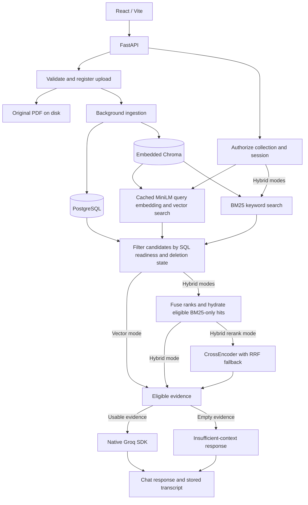

# InCite architecture

The [HTTP API](api.md), [database schema](database.md), and [deployment guide](../README.md#deployment-and-upgrades) document the current implementation.

## Application and storage

The React/Vite frontend calls the FastAPI API with a Bearer token. API routes validate requests and enforce resource ownership with the service layer. Services orchestrate ingestion, retrieval, and generation. SQLAlchemy models and repositories represent and query PostgreSQL records. Alembic manages schema migrations.

- **PostgreSQL** is authoritative for ownership, document readiness, deletion state, chunk records, chat history, and query logs.
- **Embedded Chroma** stores embeddings, searchable chunk text, and metadata in a per-collection cosine index. Reads use a native, non-creating collection lookup.
- **Local filesystem** holds the original PDFs under `UPLOAD_DIR` and Chroma data under `CHROMA_PERSIST_PATH`.
- **In-process BM25 indexes** are built lazily from Chroma text and cached per collection. Ingestion and deletion invalidate affected indexes.

## Ingestion and retrieval

Upload validates the PDF and creates a `processing` row. A FastAPI background task extracts text page by page with PyMuPDF, splits it into overlapping word-based chunks, and embeds each batch with the cached SentenceTransformer. Ingestion writes Chroma rows and matching PostgreSQL chunks using the same canonical IDs. Successful ingestion marks the document `ready`. Failure records `failed` and attempts partial-artifact cleanup.

Hybrid is the default. See [ADR 007](decisions/007-hybrid-retrieval-default.md) for the evidence behind this choice. Set `RETRIEVAL_MODE=vector` for vector-only search or `RETRIEVAL_MODE=hybrid_rerank` to opt into CrossEncoder reranking. The service embeds each query as a one-element batch using the same cached MiniLM model as ingestion. Native Chroma returns ordered results with raw cosine distances. Retrieval uses the local, Pydantic-backed `RetrievedChunk` type for both vector hits and BM25-only hydration.

Hybrid modes search independent vector and BM25 pools. PostgreSQL checks candidate document IDs in a batch, excludes pending or unavailable documents, and supplies the filenames used in responses and prompts. Hybrid retrieval verifies hydrated chunk IDs and fuses candidates using their original ranks. Optional `hybrid_rerank` applies a CrossEncoder to eligible candidates and falls back to RRF order on reranker failure. A failed SQL eligibility check yields no evidence. See [ADR 001](decisions/001-postgresql-document-eligibility.md), [ADR 004](decisions/004-native-chroma-vector-retrieval.md), and [ADR 006](decisions/006-remove-langchain-core.md).

## Generation and history

QA, comparison, and recommendation use the same eligibility checks. QA filters evidence by citation score and returns source filenames, page numbers, excerpts, and scores. Comparison and recommendation return their own structured fields. The provider sends a single user-message prompt through the official Groq SDK and validates named tool arguments with Pydantic. Services choose the fallback model order. See [ADR 005](decisions/005-native-groq-provider.md).

Prompts use fresh evidence for document claims. Up to three earlier user messages help interpret the request. Stored assistant replies remain available in the authorized transcript and are excluded from new prompts. Empty eligible evidence yields the shared insufficient-context response without a Groq call.

## Deletion and recovery

The API commits deletion intent to PostgreSQL before acknowledging the request. Pending targets are hidden from active views and excluded by subsequent eligibility checks. A FastAPI lifespan worker discovers due requests at startup and polls for more. It uses a per-collection OS lock shared with uploads and ingestion, removes matching vectors and verified PDF files, and then finalizes the SQL changes. Failed work uses bounded backoff stored in PostgreSQL. Busy collection locks briefly defer work without counting as failures. The worker retries incomplete work after restart. Collection cleanup preserves the archive row and history. See [ADR 002](decisions/002-reliable-deletion-lifecycle.md).

## Deployment

Run one application process and one replica per embedded Chroma store on local persistent storage with working OS locks. The backend Dockerfile sets `--workers 1` explicitly, including when `WEB_CONCURRENCY` is set. Persist both Chroma and uploads across deployments and supply credentials through the runtime environment. The frontend can be built separately with Vite and configured through `VITE_API_BASE_URL` and backend CORS settings.

For upgrades, stop old writers, back up PostgreSQL, Chroma, and uploads, then run `alembic upgrade head` against the intended database. Confirm the revision before starting the new process. Check the three health response bodies and confirm that due cleanup resumes.

## Known limits and future proposals

- Eligibility is a snapshot. A request past the eligibility check can still finish during concurrent deletion. Retained history can include old citations and excerpts.
- Cleanup assumes cooperating writers and one process per embedded store. See ADR 002 for recovery limits, including legacy artifacts with incomplete ownership data and Linux full-process crash verification.
- Current ingestion requires extractable PDF text. OCR, table extraction, and multimodal indexing are future proposals.
- The [historical design journal](design-decisions.md) records earlier provider, hosting, and retrieval choices. See the [engineering log](engineering-log.md) for the verification associated with each milestone.
